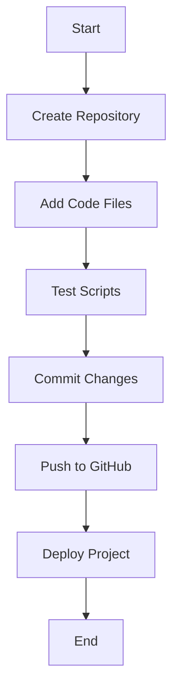

🚀 My First Repository

Welcome to My First Repository! This project serves as a beginner-friendly example for learning repository structure, version control, documentation, and basic scripting.

📖 About the Repository

This repository demonstrates how to organize a software project, document code, and visualize workflows. It is designed as a starting point for developers who are new to GitHub and collaborative development.

📘 Definition

A repository is a central location where project files, source code, documentation, scripts, and version history are stored. Repositories make it easier to manage changes, collaborate with others, and maintain projects efficiently.

✨ Features
📂 Organized project structure
⚡ Sample scripts and code examples
🔄 Workflow visualization
📚 Beginner-friendly documentation
🚀 Ready for GitHub hosting
💻 Script Example
JavaScript
function greet(name) {
    return `Hello, ${name}!`;
}

console.log(greet("Developer"));

Python
def greet(name):
    return f"Hello, {name}!"

print(greet("Developer"))

🖼️ Repository Architecture

Replace the placeholder image below with your own architecture diagram or project screenshot.

Repository Architecture Image
┌───────────────────────┐
│     Project Image     │
└───────────────────────┘

Or use Markdown image syntax:

assets/images/architecture.png

Example:

assets/images/architecture.png

🔄 Project Flowchart
┌─────────────┐
│   Start     │
└──────┬──────┘
       │
       ▼
┌─────────────┐
│ Create Repo │
└──────┬──────┘
       │
       ▼
┌─────────────┐
│ Add Files   │
└──────┬──────┘
       │
       ▼
┌─────────────┐
│ Test Code   │
└──────┬──────┘
       │
       ▼
┌─────────────┐
│   Commit    │
└──────┬──────┘
       │
       ▼
┌─────────────┐
│ Push GitHub │
└──────┬──────┘
       │
       ▼
┌─────────────┐
│   Deploy    │
└──────┬──────┘
       │
       ▼
┌─────────────┐
│    End      │
└─────────────┘

Mermaid Flowchart (GitHub Supported)

flowchart TD
    A[Start] --> B[Create Repository]
    B --> C[Add Code Files]
    C --> D[Test Scripts]
    D --> E[Commit Changes]
    E --> F[Push to GitHub]
    F --> G[Deploy Project]
    G --> H[End]

📂 Project Structure
my-first-repository/
│
├── README.md
├── index.html
├── src/
│   ├── app.js
│   └── styles.css
│
├── assets/
│   └── images/
│       └── architecture.png
│
└── docs/
    └── guide.md

🎯 Goals
Learn Git and GitHub basics
Understand repository organization
Practice writing documentation
Create reusable code examples
Visualize development workflows
📜 License

This project is available under the MIT License. Feel free to use, modify, and distribute it.

Created for learning, experimentation, and sharing knowledge with the developer community. 🌟
